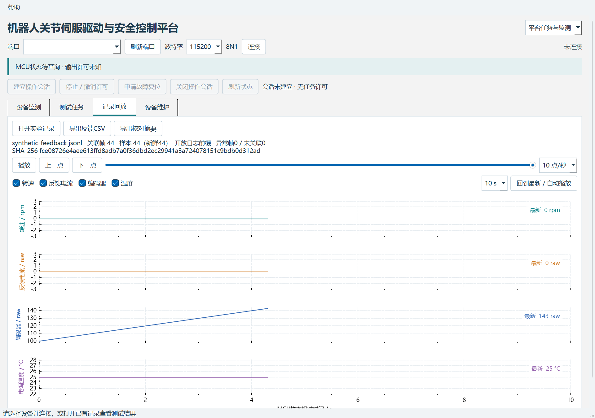
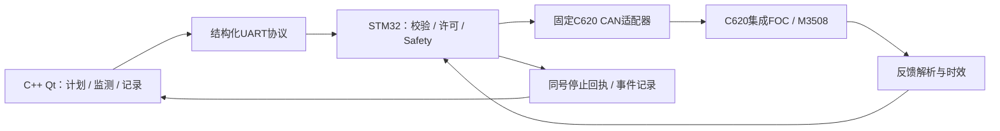

# 机器人关节伺服驱动与安全控制平台

Robot Joint Servo Drive & Safety Control Platform

基于 **STM32F407、FreeRTOS、CAN 与 C++ Qt** 构建的电机测试与安全控制平台。以 C620 集成 FOC 驱动与 M3508 电机为当前样机，将上位机测试计划、控制器任务执行、反馈监测、停止回执和实验记录串成完整的软件流程。



## 核心功能

- **结构化测试任务**：固定帧格式、CRC、参数校验、请求号关联和有限步骤计划。
- **控制器本地安全策略**：任务许可、反馈时效、幅值与期限约束、会话失联撤销、独立停止及条件故障复位。
- **FreeRTOS任务协作**：静态控制任务与串口任务分工，明确UART共享资源和中断回调所有权。
- **FOC驱动执行链**：C620集成FOC执行电流控制，STM32通过CAN组织命令、反馈、任务许可与停止控制。
- **CAN设备适配**：C620电流命令编码、编码器/转速/电流/温度反馈解析及链路状态管理。
- **C++ Qt工作台**：设备监测、测试计划、QCustomPlot曲线、记录回放、串口维护与结果导出。
- **可追溯验证**：固件主机C测试、原生Qt测试、确定性协议夹具和原始记录核对。

## 系统架构



控制器负责执行许可和本地状态，上位机负责计划组织、交互与记录。当前控制量采用C620电流命令raw，编码器反馈采用原始计数；量纲与范围由协议和设备能力配置明确表达。

## 平台演进路线

| 方向 | 规划内容 |
|---|---|
| 设备兼容 | 多厂家厂商CAN、CANopen/CiA 402、内置FOC一体式电机/驱动器适配 |
| 网络与记录 | W5500 TCP任务/遥测链路、W25Q256与AT24C256持久化 |
| 升级维护 | 控制器IAP/Bootloader、镜像校验、启动确认与A/B失败回滚 |
| 控制与测试拓展 | 上层PID、速度/位置外环、阶跃/斜坡、零位与EOL测试研究 |

当前软件模块与扩展规划分别组织，具体接口与推进顺序见[平台路线](docs/ROADMAP.md)。

## 代码导航

| 目录 | 职责 |
|---|---|
| `Core` | STM32配置代码与FreeRTOS应用入口 |
| `BSP/Can`、`BSP/Uart` | 外设适配与有界通信 |
| `Modules/Task` | 帧、Schema、任务准入和回执 |
| `Modules/Safety`、`Modules/Motion` | 会话权限、安全状态与受约束执行 |
| `Modules/C620`、`Modules/Recorder` | 电调协议与定长事件记录 |
| `PC/NativeQt` | C++上位机、原生测试与合成回放 |
| `PC/Task`、`PC/Devices` | Python离线协议参考与设备能力配置 |
| `tests` | 固件主机C回归与模拟接口 |

## 运行与构建

环境：C++17、Qt 6.8.x（Core、Widgets、SerialPort、PrintSupport、Test）、MinGW、CMake和Ninja。

```powershell
& ./PC/NativeQt/build.ps1 -QtRoot 'C:/Qt/6.8.3/mingw_64' -CompilerRoot 'C:/Qt/Tools/mingw1310_64' -RunTests
& ./build/native-qt/MotorTestPlatformNative.exe --replay ./PC/NativeQt/tests/synthetic-feedback.jsonl --page history
```

固件主机测试：

```powershell
& ./tests/run_firmware_host_tests.ps1
```

工程入口：`c_board_minimal.ioc`（CubeMX）、`MDK-ARM/c_board_minimal.uvprojx`（Keil）。工具职责、配置维护及样机操作要点见[工程说明](docs/ENGINEERING.md)。

## 进一步阅读

- [构建与测试结果](docs/VALIDATION.md)
- [上位机使用说明](PC/NativeQt/USER_GUIDE.md)
- [合成测试数据说明](PC/NativeQt/tests/FIXTURES.md)
- [第三方组件与许可](NOTICE.md)

本仓库为独立整理的作品集源码快照，包含复现所需的代码、配置和合成样例。
